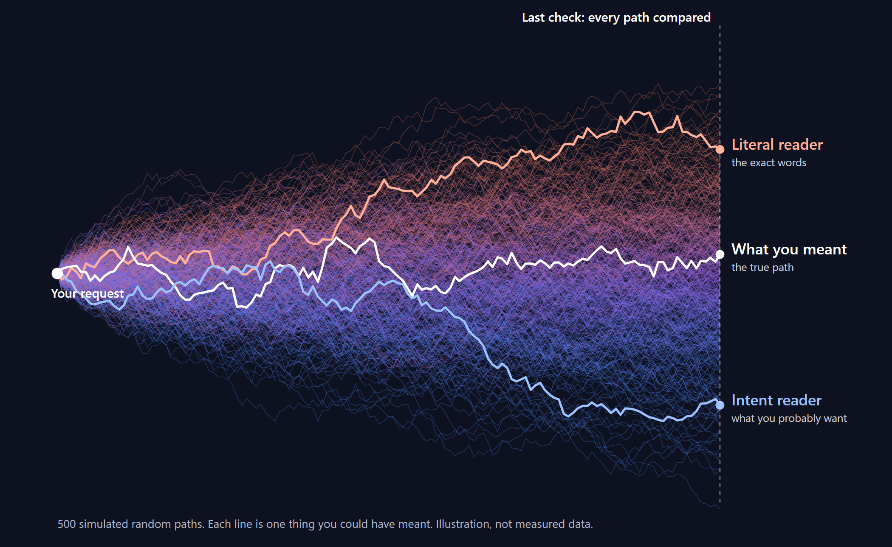
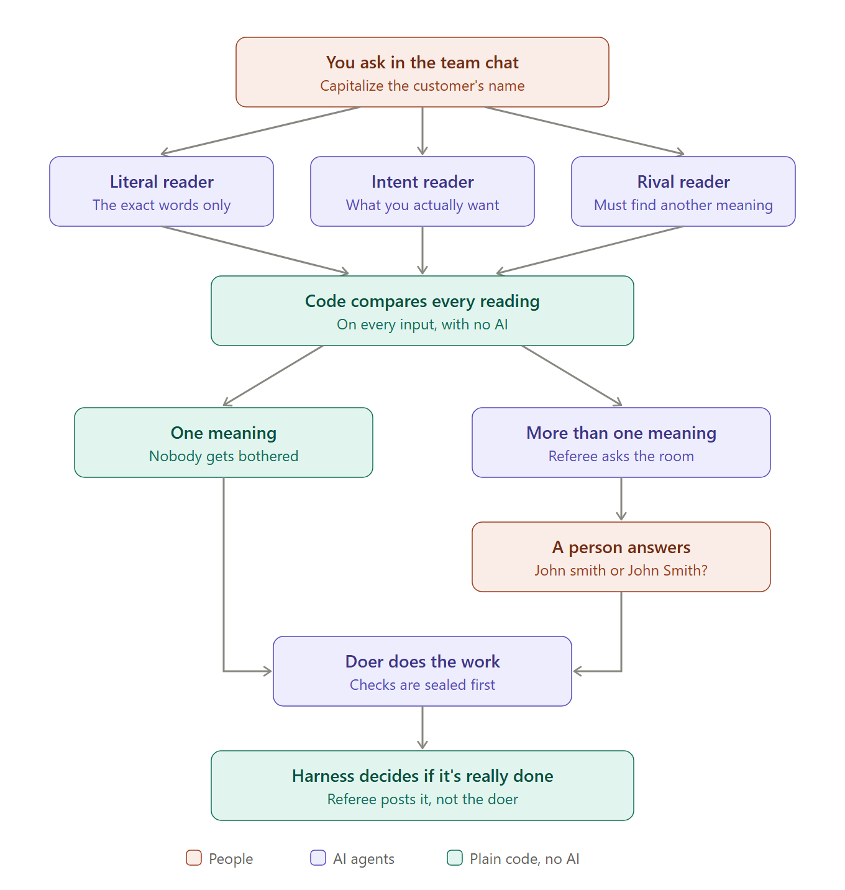
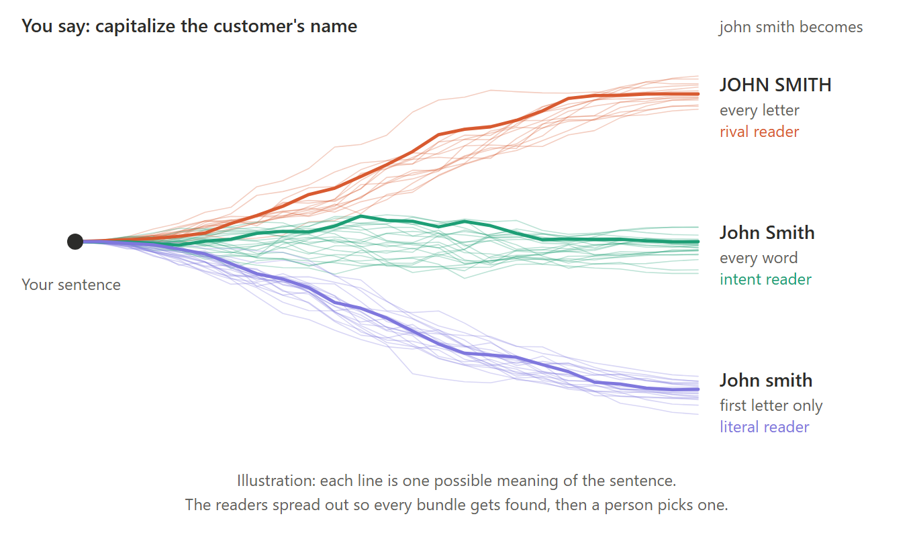

# Proofbot

Agents act on their guess of what you meant, and you only find out it was wrong after the work is done. A wrong guess feels the same to the agent as a right one, so it goes ahead confidently.

Proofbot fixes that in a [Switch](https://github.com/sandbox-quantum/switch) room, where a solo coding agent becomes a teammate you can trust. People say what they want, an agent does the work, and a referee settles the two things nobody should take on faith: **what you meant**, and **whether it's really done**.



Ask an AI to capitalize a customer's name and it might write `John smith`. The tests pass, the agent says "done", and you find out later that it wasn't what you meant. Proofbot asks first:

```text
you      @proof-doer Capitalize the customer's name on the invoice.
referee  q1: How should the customer's name look on the invoice?
           A: Only the very first letter in capitals ("john smith" becomes "John smith")
           B: The first letter of each word in capitals ("john smith" becomes "John Smith")
           C: The whole name in capitals ("john smith" becomes "JOHN SMITH")
you      B
```

That question came word for word from a real Claude Code run in the terminal, and no work started until it was answered.

## The workflow



A workflow is who does what, in what order. In this room:

| Step | Who | What happens |
| --- | --- | --- |
| 1 | A person | Asks for something in the team chat |
| 2 | `doer` | Writes its reading of the request as checks, before touching any code |
| 3 | Three readers | Each read the request from a different side and turn their reading into code |
| 4 | The harness (no AI) | Runs every reading on every input and groups the ones that behave the same |
| 5 | `referee` | One meaning: work starts and nobody is bothered. More than one: it asks the room |
| 6 | A person | Answers with a letter or in their own words. The answer binds the checks and the code |
| 7 | `doer` | Does the work |
| 8 | The harness | Reruns everything from its own sealed copy and scans for cheating |
| 9 | `referee` | Posts the verdict. `doer` never gets to say it's done |

## Why it needs Switch

The hard part of proving work was done is agreeing on what "done" means, and that's a conversation between people. Switch is where it happens:

- **The room is where meaning gets settled.** A job can't reach DONE while a question is open, and the answer can only come from a person in the chat. That rule is [proved in Lean](lean/Gate.lean).
- **Two agents, not one.** `doer` and `referee` are separate room members with separate folders, so the agent doing the work isn't the one announcing the result.
- **The whole team can answer.** The product manager can settle what a rule means without opening a terminal.
- **One import sets it all up.** [proofbot.template.yaml](proofbot.template.yaml) creates both agents and the room, and each agent runs on whichever coding agent you pick: Claude Code, Codex or OpenCode.

Switch Trust checks what agents *say*. Proofbot checks what they *did*, and whether it's what you meant.

## Run it in Switch

You need Python 3.10 or newer, git, [Switch Console](https://github.com/sandbox-quantum/switch/releases/latest), and Claude Code or Codex signed in. Proofbot itself uses only the Python standard library. A local Switch server doesn't need Docker.

1. Install Switch Console and choose **Run a server on this computer**.
2. Connect a chat app under **Home > Messaging apps**. Discord gives each agent its own name and avatar. Telegram is quicker to set up, but one bot posts for everyone.
3. Clone this repo somewhere outside the project you want to work on:

```powershell
git clone https://github.com/qunatumstuff/proofbot
```

4. In Switch Console, go to **Templates > Import template** and import `proofbot.template.yaml`. Pick your project folder, the proofbot folder and your chat app.
5. Let both agents run `python`. Switch's default auto mode may stop and ask a person before each command, which stalls the room. For a demo, allow it under each agent's settings, or set `auto_approve: true` on both agents in the template if you're happy for them to run without checks.
6. In the room, ask for something: `@proof-doer Members get 10% off orders over $50, and coupons don't stack.`

`seal` and `finish` can each take a few minutes. A whole job took about 13 minutes in testing.

## Try it without Switch

These need no setup, and each builds its own scratch project:

```powershell
python demo/lazy_agent.py meaning         # one sentence, two meanings: the readers split and a person settles it
python demo/lazy_agent.py everyday        # a permissions rule, every combination tried
python demo/lazy_agent.py regress         # a later job breaks something proven earlier
python demo/lazy_agent.py cheat           # the agent edits a test, then forges the verdict
python tests/test_bot.py                  # fake agents try every cheat. No network needed
```

The readers in `demo/lazy_agent.py meaning` are scripted so it runs anywhere. To use real ones on your own project, copy `.env.example` to `.env`, set `WORKSPACE` and `TEST_COMMAND`, then run:

```powershell
python proof.py run "Capitalize the customer's name on the invoice."
```

## Catching misunderstandings



A request is one sentence, but the person's meaning could be any of several. Two AIs that simply read it tend to make the same silent guess. In a small test, two models read five product requests separately and never disagreed on any of 215 inputs, including requests that really were ambiguous.

So [readings.py](readings.py) spreads the readers apart on purpose, like sampling different paths through what you might have meant:

| Reader | How it reads |
| --- | --- |
| `literal` | The exact words, nothing added |
| `intent` | The outcome you want, including what you'd obviously expect |
| `rival` | Must find a different reasonable meaning from the agent's, or say there isn't one |

Each reading becomes a real `expected()` function, and readers can add inputs the agent forgot, of the same kind as the ones listed. Then the harness runs them all. Two readings are the same meaning if they give the same output on every input, so this is a measurement, not an AI's opinion. It picks the fewest inputs that tell the meanings apart, up to 5,000 inputs and then a fixed random sample.

A last AI turns those inputs into plain questions. It can set a silly difference aside, and the report lists that under NOT ASKED, but it can never pick the answer. If it sets one aside and every reader disagrees with the agent, the agent has to fix its checks.

A job asks at most three questions in all, however many rounds it takes, and anything past that goes in the report. Your answers are remembered for that workspace, so the team only gets asked once. When inputs can't be listed, like "clean up the logs", readers answer in words and an AI compares them. The report says so, because that's a judgement, not a measurement.

### What real models did

These are real runs. The check in each of the first four rows was written by hand to be careless on purpose, and those four ran on both Claude Code and Codex. The last three ran on Codex, with a correct check.

| Request | Result |
| --- | --- |
| "Capitalize the customer's name on the invoice." | Asked: `John smith`, `John Smith` or `JOHN SMITH`? |
| "Members get 10% off orders over $50, and coupons don't stack." | Found 4 meanings and asked, including whether a coupon is a percent or dollars |
| "Clean up the logs." | Asked: clearer logging, or delete old files? |
| "Fix add in calc.py, add(2, 3) should return 5." (the check returned 5 for everything) | Every reader disagreed, so the agent had to fix its check |
| "Flag an invoice as overdue once it's more than 30 days old, unless it's been paid." | One meaning, nobody asked |
| "Fix add in calc.py so it adds two numbers." | One meaning, nobody asked |
| "Only admins and the post's author can delete a post. Banned users can't do anything." | Nobody asked in one run. In another, it asked whether a banned user gets "not allowed" or an error |

One whole job on Claude Code, start to finish, asked two questions, built the right thing, and ended DONE, READ THE WARNINGS because the test project had no test suite. It took about 13 minutes: each round of readers takes about a minute, and the agent's own work takes the rest.

That's a handful of requests, not a benchmark, and the AI steps don't give the same answer every time.

### Why not just tell the agent to ask?

You should. We tested it on the seven requests above. Told only "if anything is unclear, ask", Claude Code asked good questions on all three ambiguous requests and said PROCEED on the other four, in seconds. Left alone, it picked a meaning silently on all three and said it hadn't run anything. So spotting ambiguity is the cheap part, and our readers are much slower than that one line.

What a prompt can't do is make the answer stick. The agent can still get it wrong in code, say "done", and forget by the next session. The readers earn their keep because each option comes with an exact input and output, so your answer becomes a check. The code has to pass it in a process it can't tamper with, in this job and every later one.

### Three mistakes that shaped this

An AI assistant made all three of these while we were building Proofbot.

| What happened | What Proofbot does about it |
| --- | --- |
| Asked for a Monte Carlo chart, "more spread out", it drew a different kind of map. The extra words replaced the main request. | The review treats the main thing you asked for as its own part, so checks that keep the description but lose the thing fail. |
| Corrected about an example, it explained itself, then used the same example again. | A correction is a new job. It needs a check that fails on the old behaviour, and that check binds every later job. |
| Asked how to stop this happening, it patched the one example. | A correction has to cover the whole kind of mistake, and the intent reader treats your examples as examples of a rule. |

A wrong guess and a right one feel the same to an agent, so being told off doesn't change anything by itself. A check that has to keep passing does.

## Lean for agents

People let AI write proofs in Lean because they never have to trust the AI: a small kernel checks every step. But Lean can't tell you whether the theorem says what you meant. A person has to read the statement. Formal verification has the same gap for software, and [Anthropic's work on verified software](https://www.anthropic.com/research/formal-verification) lists the theorem statements among the things you still have to trust.

Proofbot applies that idea to an agent's work, and puts most of its effort into that gap.

| In Lean | In Proofbot |
| --- | --- |
| The theorem statement, written before the proof | The checks, sealed before the work starts |
| A person reads the statement | Readers find where it could mean something else, and people settle it in the room |
| A theorem holds *for all* inputs | Checks test the rule over many inputs; a one-example check is flagged NARROW |
| `decide`: proof by checking every case of a finite type | Proof by exhaustion: the harness tries every combination in a check's DOMAIN and names the first counterexample |
| The proof: written by anyone, trusted by no one | The agent's code changes |
| The kernel | `proof.py`: reruns the sealed checks, your tests and the loophole scan |
| `sorry` | Skipped, deleted or weakened tests and edited checks, all flagged |
| `#print axioms` | THIS PROOF RELIES ON, at the end of every report |
| Mathlib: proven once, stays proven | The proven library: a later job that breaks an earlier proof is NOT DONE |

This is an analogy: checks are Python running on chosen inputs, not proofs about all programs. A proof by exhaustion covers its domain and nothing beyond it, and the report says so. There is one real Lean file, [lean/Gate.lean](lean/Gate.lean), which proves the verdict rule can't reach DONE with a question open. It proves things about the rule, not about Python, and `tests/test_bot.py` checks that `proof.py` follows the same rule in all 64 cases when Lean is installed.

Other projects bring Lean to agents too. [Lean4Agent](https://arxiv.org/abs/2606.06523) checks agent workflows, and the [Lean-Agent Protocol](https://arxiv.org/abs/2604.01483) gates each action against rules formalized in Lean. Those check an agent against rules someone already wrote down. Proofbot works one step earlier, on whether what got written down is what the person meant.

## How the proof works

1. **Before:** the harness snapshots the workspace and runs your tests and every check in the proven library.
2. **Checks first:** the agent writes acceptance checks in `proof_checks/`, without doing the task.
3. **Seal:** the harness copies those checks outside the agent's folder and runs them. They must fail now, because a check that already passes proves nothing.
4. **Readers and review:** readers look for other meanings, and a second AI says which check tests each part of your request.
5. **Questions:** people settle anything left open, the agent updates its checks, and step 3 runs again.
6. **Work:** the agent does the task.
7. **Proof:** the harness reruns its sealed copy of the checks, your tests and the library, compares the code with what you decided, diffs the workspace, and scans for cheating. Then it writes the report and a receipt ID.
8. **Library:** when a job is DONE, its checks join the proven library, and every later job must keep them passing.

A report opens with one of **DONE AND PROVEN**, **DONE, READ THE WARNINGS**, **NOT DONE** or **UNPROVEN** (nothing could prove it either way).

| How an agent goes wrong | What catches it |
| --- | --- |
| Reads you too literally, or picks one meaning silently | Readers split, and it stops for a question |
| Keeps the description but loses the main thing you asked for | The review marks that part wrong |
| Gets corrected, then repeats the mistake | The correction's check is in the proven library: NOT DONE |
| Keeps its own reading after you answered | The harness compares its checks with your answer |
| Builds the old thing anyway | The code is called on the exact inputs you decided |
| Drops part of the task | The second AI's review |
| Checks one example, then special-cases it | The review flags it NARROW, and readers add inputs |
| Writes a check that compares the code with itself | `expected()` runs without the project, so it fails |
| Exits early, forges output, or returns an object equal to anything | The code and `expected()` run in separate processes and the harness compares plain outputs |
| Breaks something an earlier job proved | The proven library: NOT DONE |
| Says "done" without changing anything | "no project files changed" |
| Edits the checks so they pass | The harness runs its sealed copy |
| Writes checks that pass no matter what | They pass before the work, so the job is UNPROVEN |
| Skips, deletes or weakens your tests | Each is flagged, and NOT DONE |
| Edits the report it sends you | `verify` catches a changed copy |

`python tests/test_bot.py` acts out each of these with a fake agent.

## Limits

- **Readers agreeing doesn't prove the meaning.** It makes a misunderstanding less likely, and the report says so. A reader can miss an input, and models share blind spots.
- **A correction is only as strong as its check.** If the check misses the mistake, the mistake can come back. What you decided is also given to the agent as a rule, but only the checks enforce it.
- **Only listable inputs are measured.** Free text and how a page looks fall back to an AI comparing readings in words.
- **The AI steps can be wrong.** The review and the last check are judgements. In a Switch room, `referee` is also an AI passing on the harness's output, so "only a person's answer counts" is its instruction, not something code enforces.
- **On one computer, the folders aren't a wall.** An agent that can write to the proofbot folder could forge job files that `verify` accepts, because receipts aren't signed. Proofbot blocks this when run directly: with Claude Code the agent gets file tools limited to the workspace, and Codex has its sandbox. Inside a Switch room, check how your agent is confined.
- **Code can still tell it's being tested.** Code that detects the harness and behaves differently would pass. THIS PROOF RELIES ON says so. Checks without a DOMAIN run in one process with the code, and the report names them.
- **With Claude Code, checks run as you.** The sandbox comes from Codex, so AI-written checks run with your full access unless you use `AGENT=codex`.
- If you change a requirement on purpose, delete its file in `home/library/` and its line in `library.json`, or every later job will be NOT DONE.
- The harness snapshots the workspace with git and runs `git init` if the folder has none. It never commits or changes your branch.
- Jobs run one at a time. A task that is a question, not a change, comes back UNPROVEN, because there's nothing to check.
- `python proof.py run` with nobody at the keyboard can't ask you anything. The agent then works on its best reading, and the job ends UNPROVEN.

## Commands

```powershell
python proof.py doctor                     # can the checks run here?
python proof.py run "your task"            # one whole job from the terminal
python proof.py begin "your task"          # step 1, for an agent that runs the steps itself
python proof.py begin "what went wrong" --correction   # a correction: it becomes a check that binds later jobs
python proof.py seal 3                     # seal the checks, spread the readers, print any questions
python proof.py questions 3                # what still needs answering
python proof.py answer 3 q1 B --who kim    # record a person's answer: a letter, or their own words
python proof.py finish 3 --claim "..."     # prove it and print the report
python proof.py show 3                     # a job's report
python proof.py verify 3 P3-... --recheck  # is the receipt genuine, and do the checks still pass?
```

`.env.example` lists the settings. `AGENT=claude` or `AGENT=codex` picks the AI, and Claude Code is the default when it's installed. Working alone from your phone? There's also a [WhatsApp front end](docs/whatsapp.md).
